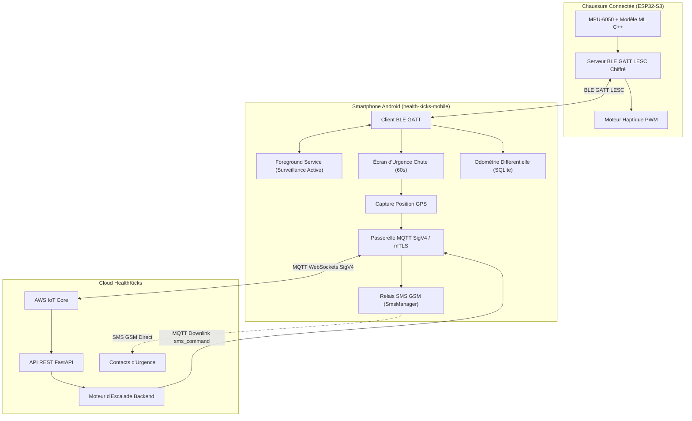

# HealthKicks Mobile (`health-kicks-mobile`)

Application mobile compagnon, passerelle **BLE-to-MQTT** et relais de secours pour l'écosystème de chaussures connectées **HealthKicks**.

Développée avec **Flutter**, l'application sert de pont temps réel sécurisé entre la semelle intelligente (firmware ESP32-S3), le patient et le Cloud AWS IoT Core.

---

## 1. Rôle & Responsabilités d'Architecture

---

## 2. Fonctionnalités Principales

### A. Mode Surveillance Active (Foreground Service)
- Maintien continu de la connexion BLE en arrière-plan grâce à un service de premier plan Android (`Foreground Service`) conforme aux exigences d'économie d'énergie.
- Reconnexion automatique avec backoff exponentiel lors des déconnexions transitoires.
- Indicateur persistant dans la barre de notifications confirmant la surveillance biomécanique en cours.

### B. Prise en Charge Immédiate des Chutes & Écran d'Alerte (60 secondes)
- Réception instantanée des notifications d'événements de chute émis par l'ESP32-S3 (`7a5a0002-...`).
- Déclenchement d'un écran plein format d'alerte avec compte à rebours de 60 secondes, vibrations haptiques et avertisseur sonore.
- **Annulation par le patient** : Un bouton *« Je vais bien »* permet d'annuler immédiatement l'alerte (`CANCEL`, motif `user_cancel`), arrêtant la chaîne d'alerte avant toute notification des proches.
- **Annulation automatique par relevage** : Si la semelle détecte que la personne s'est relevée (`fall_recovery`, code `0x13`), l'alerte s'annule automatiquement.
- **Confirmation manuelle** : Un bouton *« J'ai besoin d'aide »* saute le décompte et déclenche immédiatement l'escalade vers les proches (`CONFIRM`).

### C. Géolocalisation GPS en Direct
- Dès la détection d'une chute, l'application capture les coordonnées géographiques précises du smartphone (`latitude`, `longitude`, `précision en mètres`, `horodatage`).
- Ces coordonnées sont encapsulées dans le message MQTT de détection et transmises au Cloud pour permettre aux proches d'ouvrir l'itinéraire Google Maps en un clic.

### D. Relais SMS Local Automatisé (`SmsManager`)
- Lorsque le backend escalade l'alerte vers un contact disposant d'un numéro de téléphone, il transmet un ordre `sms_command` via le topic MQTT Downlink `healthkicks/v1/users/{user_id}/fall-alert/status`.
- L'application mobile intercepte cet ordre en tâche de fond et utilise l'API native Android `SmsManager` pour émettre directement le SMS de détresse au contact d'urgence avec le lien sécurisé de prise en charge.
- L'application renvoie un rapport d'état d'émission (`SMS_STATUS: SENT` ou `SMS_STATUS: FAILED`) au backend pour garantir la traçabilité de l'escalade.

### E. Odométrie Différentielle & Podométrie
- Calcul différentiel des pas journaliers ventilés par type d'activité (marche, course, etc.).
- Persistance locale dans une base SQLite embarquée.
- Synchronisation périodique avec l'API Cloud via `POST /api/v1/steps/sync`.

### F. Mode Studio & Transfert IMU Haute Vitesse (Fast Burst)
- Démarrage et orchestration de sessions de calibration et d'entraînement (commande `START <label> <duration_sec> <session_id>`).
- Réception et réassemblage des flux de paquets IMU bruts à haute fréquence (`7a5a0005-...`).
- Vérification d'intégrité par contrôle CRC32 et transmission des séries temporelles à Amazon DynamoDB.

---

## 3. Dépendances & Stack Technique

- **Framework** : Flutter 3.24+ / Dart 3.5+
- **Connectivité BLE** : `flutter_blue_plus` (support appairage sécurisé LESC Numeric Comparison)
- **Passerelle IoT** : `mqtt_client` avec authentification AWS SigV4 over WebSockets (négociation de jetons AWS STS temporaires via le backend)
- **Téléphonie & SMS** : Plugin Android natif `telephony` / `SmsManager`
- **Géolocalisation** : `geolocator`
- **Stockage Local** : `sqflite` (base SQLite locale) & `flutter_secure_storage` (jetons chiffrés)
- **Architecture Applicative** : Clean Architecture & State Management réactif

---

## 4. Conformité aux Contrats

L'ensemble des échanges BLE, MQTT et REST respecte rigoureusement les contrats de l'écosystème :
- Contrat BLE GATT : [`contracts/ble_gatt_specs.md`](../contracts/ble_gatt_specs.md)
- Contrat Alerting Chute & SMS : [`contracts/fall_alerting.md`](../contracts/fall_alerting.md)
- Protocole Burst Studio : [`contracts/studio_burst_protocol.md`](../contracts/studio_burst_protocol.md)
- Vue d'ensemble des contrats : [`contracts/README.md`](../contracts/README.md)
