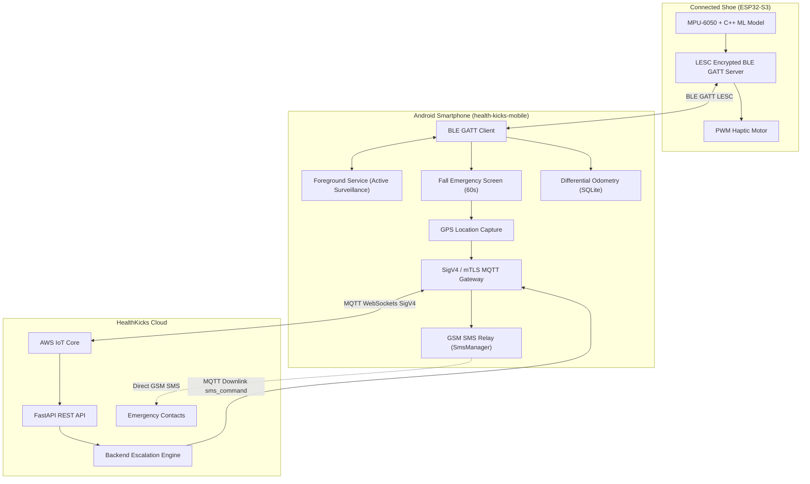

# HealthKicks Mobile (`health-kicks-mobile`)

Mobile companion application, **BLE-to-MQTT** gateway, and emergency relay for the **HealthKicks** connected shoe ecosystem.

Developed with **Flutter**, the application acts as a secure real-time bridge connecting the smart insole (ESP32-S3 firmware), the patient, and the AWS IoT Core Cloud.

---

## 1. Architectural Role & Responsibilities

---

## 2. Key Features

### A. Active Surveillance Mode (Foreground Service)
- Continuous background BLE connection via an Android `Foreground Service` compliant with battery optimization policies.
- Automatic reconnection with exponential backoff on transient disconnections.
- Persistent status notification in the notification bar confirming ongoing biomechanical monitoring.

### B. Immediate Fall Handling & Emergency Alert Screen (60 Seconds)
- Instant reception of fall event notifications emitted by the ESP32-S3 (`7a5a0002-...`).
- Full-screen countdown alert UI (60 seconds) with haptic vibrations and sound signals.
- **Patient cancellation**: An *"I'm okay"* button immediately cancels the alert (`CANCEL`, reason `user_cancel`), stopping the escalation chain before notifying emergency contacts.
- **Automatic recovery cancellation**: If the insole detects that the user got back up (`fall_recovery`, code `0x13`), the alert cancels automatically.
- **Manual confirmation**: An *"I need help"* button skips the countdown and immediately escalates the alert to emergency contacts (`CONFIRM`).

### C. Live GPS Geolocation
- Upon fall detection, the application captures high-precision smartphone GPS coordinates (`latitude`, `longitude`, `accuracy in meters`, `timestamp`).
- These coordinates are encapsulated within the detection MQTT payload and forwarded to the Cloud, enabling contacts to open the exact Google Maps location with one click.

### D. Automated Local SMS Relay (`SmsManager`)
- When the backend escalates an alert to a contact with a registered phone number, it transmits an `sms_command` instruction via the downlink MQTT topic `healthkicks/v1/users/{user_id}/fall-alert/status`.
- The mobile app intercepts this command in the background and uses native Android `SmsManager` to dispatch the emergency distress SMS directly to the contact with a secure rescue link.
- The app returns a delivery status report (`SMS_STATUS: SENT` or `SMS_STATUS: FAILED`) to the backend to ensure end-to-end escalation traceability.

### E. Differential Odometry & Step Counting
- Differential calculation of daily step counts broken down by activity type (walking, running, etc.).
- Local persistence in an embedded SQLite database.
- Periodic synchronization with Cloud API via `POST /api/v1/steps/sync`.

### F. Studio Mode & High-Speed IMU Transfer (Fast Burst)
- Initiation and orchestration of calibration and training sessions (`START <label> <duration_sec> <session_id>`).
- Reception and reassembly of high-frequency raw IMU packet bursts (`7a5a0005-...`).
- CRC32 integrity verification and telemetry forwarding to Amazon DynamoDB.

---

## 3. Dependencies & Tech Stack

- **Framework**: Flutter 3.24+ / Dart 3.5+
- **BLE Connectivity**: `flutter_blue_plus` (LESC Numeric Comparison secure pairing support)
- **IoT Gateway**: `mqtt_client` with AWS SigV4 over WebSockets authentication (temporary AWS STS token negotiation via backend)
- **Telephony & SMS**: Android native plugin `telephony` / `SmsManager`
- **Geolocation**: `geolocator`
- **Local Storage**: `sqflite` (local SQLite database) & `flutter_secure_storage` (encrypted tokens)
- **Application Architecture**: Clean Architecture & Reactive State Management

---

## 4. Contract Compliance

All BLE, MQTT, and REST interactions strictly adhere to ecosystem contracts:
- BLE GATT Contract: [`contracts/ble_gatt_specs.md`](../contracts/ble_gatt_specs.md)
- Fall Alerting & SMS Contract: [`contracts/fall_alerting.md`](../contracts/fall_alerting.md)
- Studio Burst Protocol: [`contracts/studio_burst_protocol.md`](../contracts/studio_burst_protocol.md)
- Contracts Overview: [`contracts/README.md`](../contracts/README.md)
